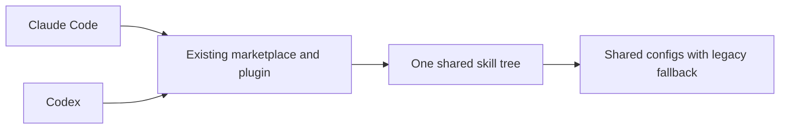

# Codex support

Make the existing plugin work reliably in Codex while retaining one shared implementation for
Claude Code. Codex 0.162.1 already reads the existing marketplace and plugin manifests; the work
is in portable instructions, config discovery, and installation documentation.

| Concern | Source |
| --- | --- |
| Scope | [PROMPT.md](PROMPT.md) |
| Work and exit conditions | [ROADMAP.md](ROADMAP.md) |
| User-facing compatibility contract | [../../codex.md](../../codex.md) |
| Marketplace | [../../../.claude-plugin/marketplace.json](../../../.claude-plugin/marketplace.json) |
| Plugin metadata | [../../../plugins/fabien-skills/.claude-plugin/plugin.json](../../../plugins/fabien-skills/.claude-plugin/plugin.json) |
| Shared workflows | [../../../plugins/fabien-skills/skills/](../../../plugins/fabien-skills/skills/) |

## Validation record

Validated with Codex CLI 0.162.1:

- The native app-server `plugin/read` operation resolved all nine skills and bundled resources
  from this checkout at version 0.10.0.
- A separate package copy with a unique marketplace/plugin identity returned `installed: false`
  and still loaded all nine skills. No plugin installation or user config modification was needed.
- Native `skills/list` discovered all nine skills through standalone directory symlinks in a
  scratch repo, with no skill errors.
- All nine skills passed the skill-creator frontmatter validator. Both manifests passed JSON
  parsing and `claude plugin validate`, with no manifest warnings.
- An independent agent performed `gitmoji` in a scratch repo without injected context or
  `CLAUDE_SKILL_DIR`: only the staged file was committed; unrelated changes and an untracked
  file remained untouched.
- Independent instruction review traced config precedence, explicit missing-path errors,
  outside-home lookup, unavailable integrations, planning continuation, and direct-review
  fallback. It caught a missing sequential verifier fallback, which was added.

These checks cover loading and representative behavior. They do not claim a fresh installation
through the desktop UI, full execution of every skill, or live Slack/Jira/Linear integration tests.
